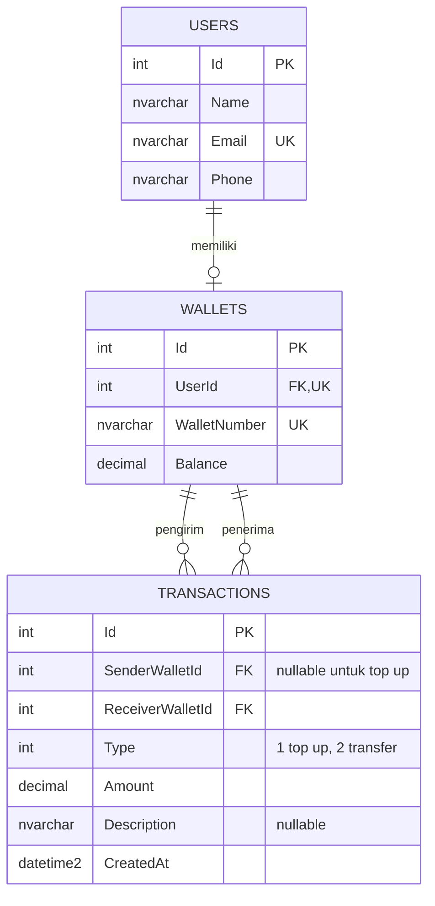
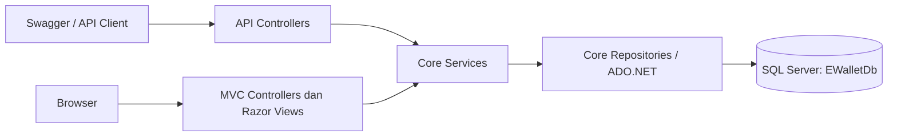
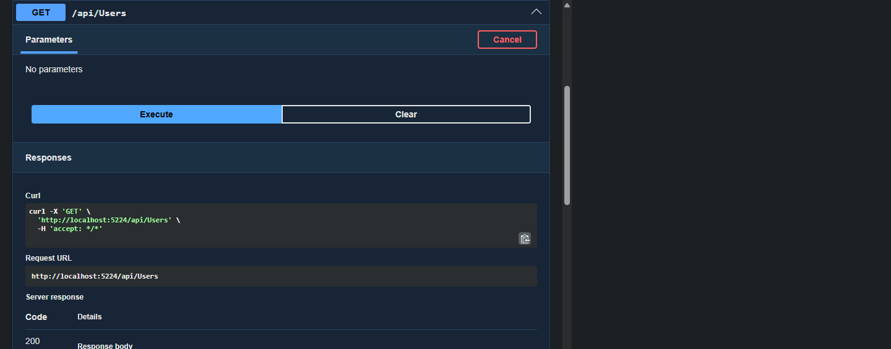
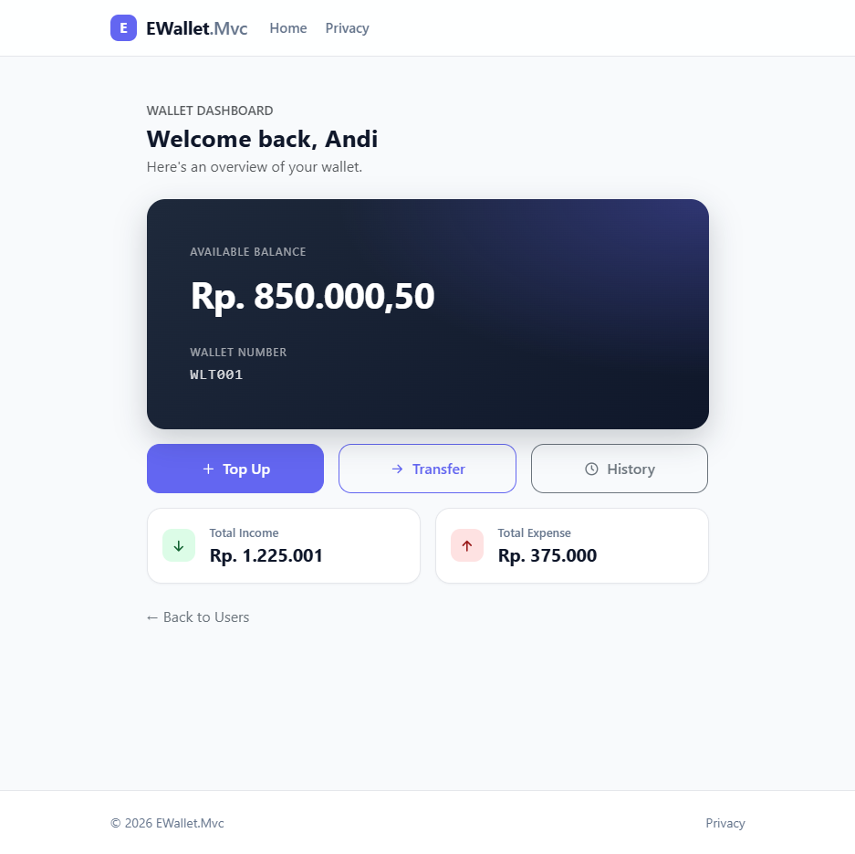
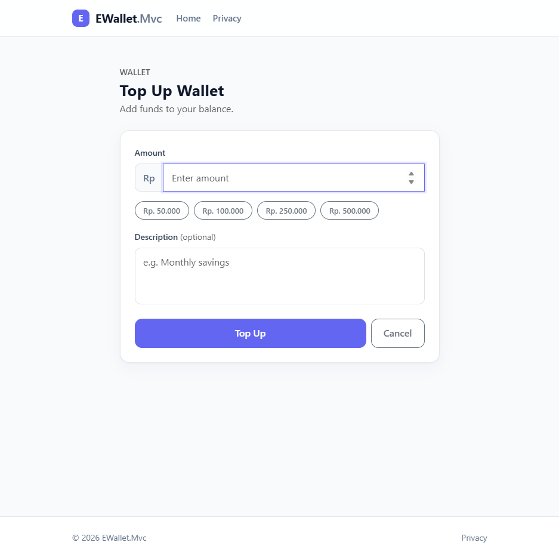
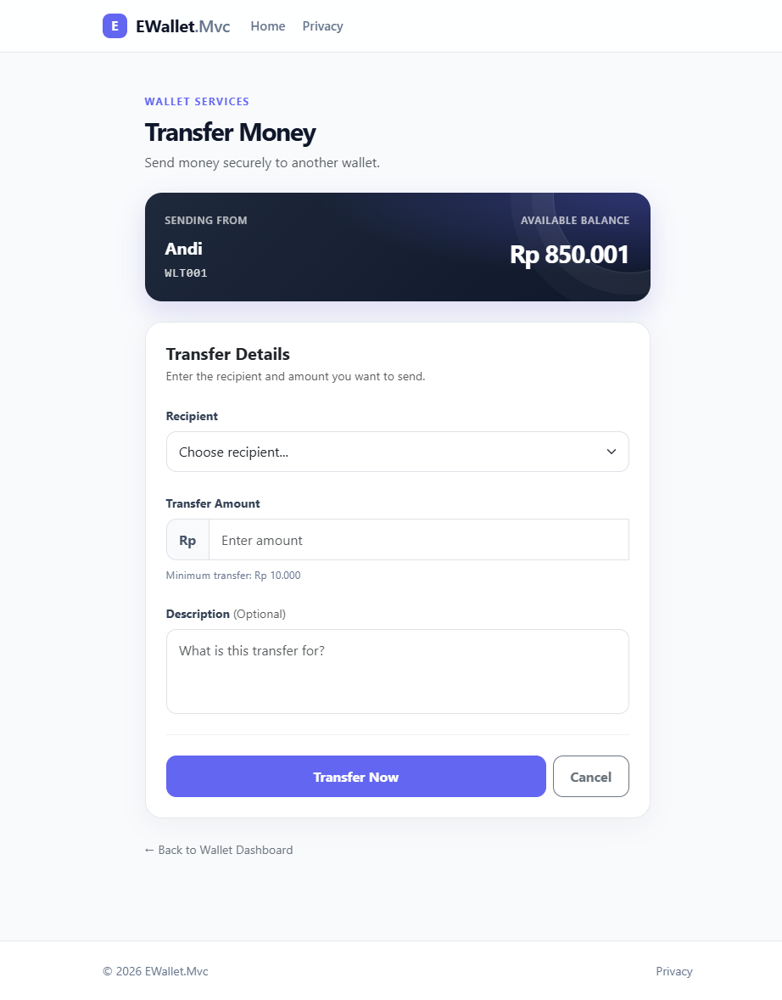
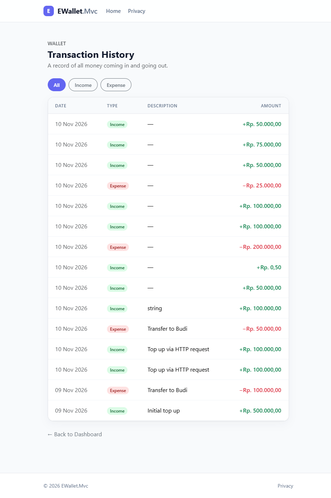

# E-Wallet

Aplikasi dompet digital sederhana untuk mengelola pengguna, saldo, top up, transfer, dan riwayat transaksi. Dibuat dengan ASP.NET Core Web API, ASP.NET Core MVC (Razor Views), SQL Server, dan ADO.NET.

## Fitur

- Melihat daftar pengguna dan memilih akun.
- Membuat pengguna beserta wallet dan memperbarui data pengguna melalui API.
- Melihat saldo serta ringkasan pemasukan dan pengeluaran.
- Melakukan top up dan transfer antar-wallet.
- Melihat riwayat transaksi dan memfilter pemasukan atau pengeluaran.
- Menjaga konsistensi saldo dan catatan transaksi menggunakan transaksi database.

## Struktur Project

```text
weekly5/
├── EWallet.slnx
└── src/
    ├── EWallet.Api/
    │   ├── Controllers/       # REST API: Users, Wallets, Transactions
    │   ├── Handlers/          # Penanganan exception API
    │   └── Program.cs         # DI, Swagger, dan HTTP pipeline
    ├── EWallet.Core/
    │   ├── Data/              # Koneksi SQL Server
    │   ├── DTOs/              # Request dan response API
    │   ├── Enums/             # Jenis transaksi
    │   ├── Exceptions/
    │   ├── Interfaces/        # Kontrak repository dan service
    │   ├── Models/            # User, Wallet, Transaction
    │   ├── Repositories/      # Query dan perintah ADO.NET
    │   ├── Services/          # Aturan bisnis
    │   └── database/          # Skrip database, tabel, seed, migrasi
    └── EWallet.Mvc/
        ├── Controllers/       # HomeController dan WalletController
        ├── ViewModels/
        ├── Views/             # Razor Views
        └── wwwroot/           # CSS, JavaScript, dan pustaka frontend
```

## ERD



Satu pengguna memiliki maksimal satu wallet; setiap wallet terhubung ke satu pengguna. Wallet dapat menjadi pengirim atau penerima banyak transaksi. Pada top up, `SenderWalletId` bernilai `NULL` karena dana berasal dari luar sistem.

## Alur API dan MVC

API dan MVC berbagi lapisan `EWallet.Core` dan database. MVC **tidak** memanggil API; keduanya menggunakan service dan repository yang sama.



### Alur API

1. Client mengirim HTTP request ke endpoint API.
2. Controller menerima request dan meneruskannya ke service di `EWallet.Core`.
3. Service memvalidasi aturan bisnis dan meminta repository mengakses database.
4. API mengembalikan response HTTP; dokumentasi dan uji manual tersedia melalui Swagger.

### Alur MVC

1. Pengguna memilih akun atau aksi wallet di browser.
2. `HomeController` atau `WalletController` memanggil service di `EWallet.Core`.
3. Service dan repository membaca atau mengubah data SQL Server.
4. Controller mengirim model ke Razor View untuk ditampilkan sebagai halaman.

## Daftar Endpoint API

Base URL: `http://localhost:5224`

Swagger UI (environment Development): `http://localhost:5224/swagger`

| Method | Endpoint | Kegunaan |
|---|---|---|
| GET | `/api/Users` | Melihat seluruh pengguna |
| GET | `/api/Users/{id}` | Melihat detail pengguna |
| POST | `/api/Users` | Membuat pengguna dan wallet |
| PUT | `/api/Users/{id}` | Memperbarui pengguna |
| GET | `/api/Wallets/{userId}` | Melihat wallet berdasarkan pengguna |
| POST | `/api/Wallets/{userId}/topups` | Menambah saldo wallet |
| POST | `/api/transfers` | Transfer antar-wallet |
| GET | `/api/users/{userId}/transactions` | Melihat riwayat transaksi pengguna |

## Menjalankan Project

### Prasyarat

- .NET 10 SDK
- Microsoft SQL Server
- SSMS atau aplikasi pengelola SQL lainnya (opsional)

### 1. Siapkan database

Jalankan skrip berikut di SQL Server secara berurutan:

1. `src/EWallet.Core/database/01_create_database.sql`
2. `src/EWallet.Core/database/02_create_table.sql`
3. `src/EWallet.Core/database/03_seed_data.sql`

Untuk database yang sudah dibuat sebelum perubahan struktur transaksi, tinjau dan jalankan skrip migrasi `src/EWallet.Core/database/04_migrate_transactions.sql` bila diperlukan. Jalankan skrip seed satu kali per database baru.

### 2. Atur connection string

Perbarui `ConnectionStrings:DefaultConnection` pada:

- `src/EWallet.Api/appsettings.json`
- `src/EWallet.Mvc/appsettings.json`

Contoh Windows Authentication:

```json
{
  "ConnectionStrings": {
    "DefaultConnection": "Server=localhost;Database=EWalletDb;Trusted_Connection=True;TrustServerCertificate=True"
  }
}
```

Sesuaikan nama server dan metode autentikasi dengan konfigurasi lokal. Jangan menyimpan kredensial database ke repository.

### 3. Jalankan API dan MVC

Dari direktori root repository, buka dua terminal.

Terminal pertama — API:

```bash
dotnet run --project src/EWallet.Api
```

Terminal kedua — MVC:

```bash
dotnet run --project src/EWallet.Mvc
```

Alamat default dari launch profile:

- MVC: `http://localhost:5096`
- API: `http://localhost:5224`
- Swagger: `http://localhost:5224/swagger` (Development)

## Hasil Testing

- **Build:** `dotnet build EWallet.slnx` berhasil — 0 error dan 0 warning. Build diverifikasi dengan output sementara karena proses MVC yang sedang aktif mengunci output build standar.
- **Uji API manual:** `GET /api/Users` dijalankan melalui Swagger dan menghasilkan **HTTP 200 OK**.
- **Test otomatis:** repository belum memiliki project atau test case unit/integrasi khusus.

### Screenshot

#### Swagger / API testing

Hasil pemanggilan endpoint pengguna melalui Swagger (HTTP 200):



#### Razor MVC

Dashboard wallet:



Top up:



Transfer:



Riwayat transaksi dan filter:



## Aturan Bisnis

- Nominal top up dan transfer harus lebih besar dari nol.
- Pengguna tidak dapat mentransfer dana ke wallet sendiri.
- Transfer ditolak bila saldo pengirim tidak mencukupi.
- Saldo pengirim, saldo penerima, dan catatan transaksi diperbarui dalam satu transaksi database agar dapat di-rollback jika gagal.
- Pembuatan pengguna dan wallet juga dilakukan dalam satu transaksi database.
- `Description` transaksi bersifat opsional.

---

Dibuat untuk keperluan pembelajaran dan presentasi proyek.
